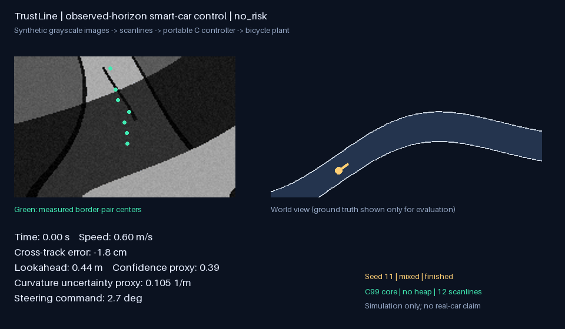
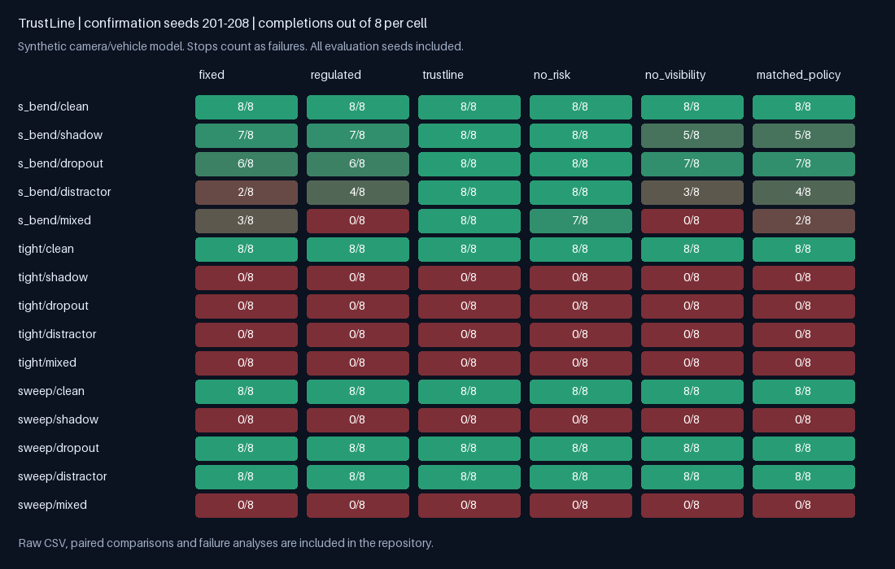
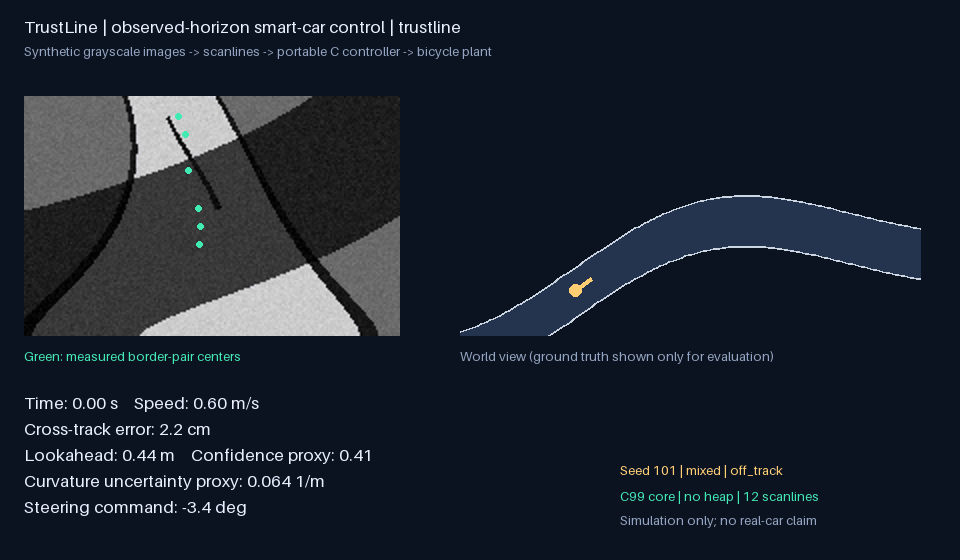

# TrustLine

**Observed-horizon control for grayscale smart cars — C99 core, image-driven closed-loop simulation, reproducible ablations.**

面向传统摄像头竞速智能车的研究工程原型：从 188×120 灰度图提取局部赛道，约束对未观测区域的外推，并将观测范围和拟合质量用于速度建议。



上图为开发种子 11 的 S 弯混合干扰示例（Lite / `no_risk`），不是总体成绩。下面提供全部评估结果和失败示例。

## 为什么做这个项目

摄像头在阴影、断线和干扰线下可能得到错误的中线。直接把估计曲线当真值会让转向目标跳变；一味拉长前瞻又可能把目标选到没有观测支持的地方。

TrustLine 用一个小而可解释的方案研究这个问题：

1. **C 灰度图扫描 + 稳健二次拟合**：12 条扫描行、边界配对和 Huber 加权；固定数组，不使用堆内存。
2. **观测范围约束前瞻**：枚举 9 个候选，兼顾车速相关的前瞻偏好和超过已测量范围的外推惩罚。
3. **观测范围限速**：结合曲率、制动距离启发式和拟合质量给出速度建议；短暂丢线保持上一曲率，长丢线给出零速建议。
4. **可被实验推翻的设计**：额外测试误差传播后的转向曲率不确定性项，用消融检查它是否有独立收益。

第一阶段中，Lite（`no_risk`）比包含不确定性项的原型完赛更多；第二阶段两者接近。两个版本均保留，具体结果见报告。

独立确认阶段：完整方法 **72/120（60.0%）**，Lite **71/120（59.2%）**；固定前瞻和同限速策略固定前瞻均 **58/120（48.3%）**，曲率调速 **57/120（47.5%）**。完整方法与 Lite 的差异很小，不确定性项的作用仍不确定。可靠性收益伴随速度代价，见配对耗时对比。

## 结果与限制



- 第一阶段：3 类赛道 × 5 类环境 × 8 个种子 × 6 种方法，720 次运行。
- 第二阶段：换用 8 个新种子，参数冻结，再做 720 次独立确认。
- 固定前瞻、曲率调速、相同限速策略的固定前瞻，以及两个消融共同参与对比。
- 统计完赛、出界、停滞、耗时、横向误差和转向总变化。停车不算完赛；耗时和误差的关键对比只使用共同完赛的配对运行。

完整结果：[实验报告](docs/EXPERIMENTS.zh-CN.md)、[第一阶段逐次CSV](results/evaluation/runs.csv)、[第二阶段逐次CSV](results/confirmation/runs.csv)。

实验使用合成投影和含执行器滞后的运动学模型。当前未进行实车验证和 RT1064 性能测量，模型不包含侧滑、坡道、十字或环岛。观测范围限速是一条启发式规则。设计依据见 [算法说明](docs/ALGORITHM.zh-CN.md) 与 [参考资料](docs/REFERENCES.md)。

失败案例同样保留：



上图为原始完整方法 `trustline` 在评估种子 101 / S 弯 / 混合干扰中的出界案例。演示有选择，统计不筛除失败。

## 一键运行

需要 Python 3.10+。支持 Zig C 编译器；Linux/macOS 也可用已有 GCC/Clang。首次运行会编译 C 核心到 `build/`。当前本地验证平台为 Windows x64 / Python 3.12，GitHub Actions 已配置但尚未在远程执行。

```bash
python -m venv .venv
# Windows PowerShell:
.venv\Scripts\Activate.ps1
# Linux/macOS: source .venv/bin/activate
pip install -r requirements.txt

python -m unittest discover -s tests -v
python run_benchmark.py --quick --out results/quick
python make_demo.py
```

完整复现：

```bash
python run_benchmark.py --workers 8 --seed-start 101 --out results/evaluation
python run_benchmark.py --workers 8 --seed-start 201 --out results/confirmation
python make_report.py
python make_demo.py --seed 101 --method trustline --prefix stress_case
```

机器资源较少时把 `--workers 8` 改为 2 或 1；计算结果不依赖线程数。需要处理真实保存图片时，可额外安装 `opencv-python-headless`，使用 `vision.from_opencv`，但必须先替换模拟标定。

## 代码结构

```text
core/trustline.{c,h}        灰度图扫描、拟合、前瞻与速度决策
trustline/native.py        编译与 ctypes；调用实际 C 核心
trustline/vision.py        合成标定与 Python 扫描参考实现
trustline/simulator.py     灰度渲染、随机扰动、车辆模型、评价
run_benchmark.py           多场景、多种子、基线与消融
make_demo.py               从实际闭环轨迹生成 GIF/日志
make_report.py             自动生成报告和场景成绩图
tests/                     7 项行为与跨语言一致性检查
docs/                      原理、实验、移植、学习与引用
results/                   原始逐次结果、协议和代码哈希
```

## 从桌面到 RT1064

目标适配平台是 RT1064 + 灰度摄像头 + 前轮舵机 + 编码器测速。C 核心不依赖 OpenCV、Python 或厂商驱动。复制两份 C 文件，换成实测地面投影、轴距、舵机标定和制动参数，再接入用户自己的速度闭环。IMU 当前尚未使用。

详见 [移植说明](docs/PORTING.zh-CN.md) 和 [代码阅读指南](docs/LEARNING.zh-CN.md)。

## References and license

Related methods and papers are listed in [References](docs/REFERENCES.md). The uncertainty penalty is an experimental variant; both evaluation stages and ablation results are included.

License: MIT.
